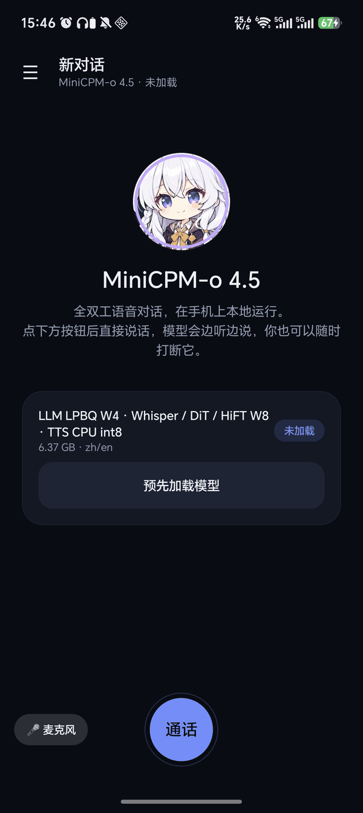
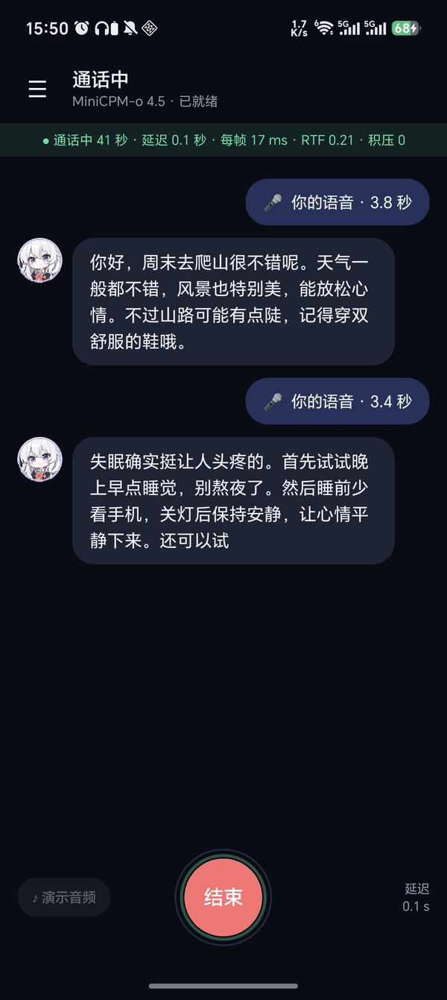
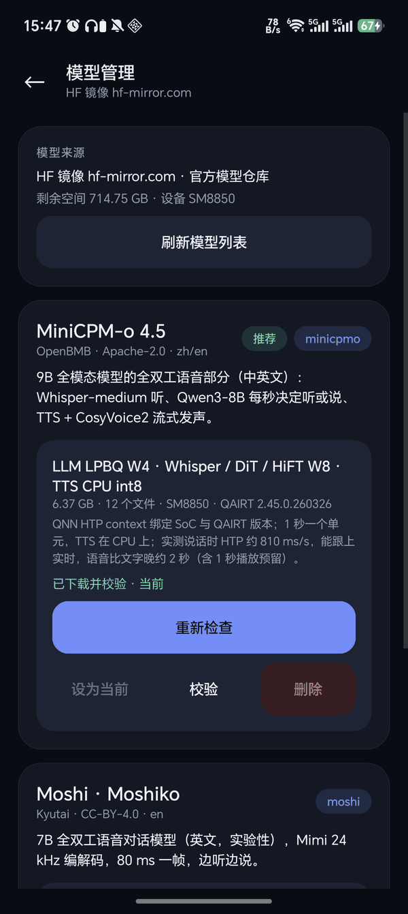
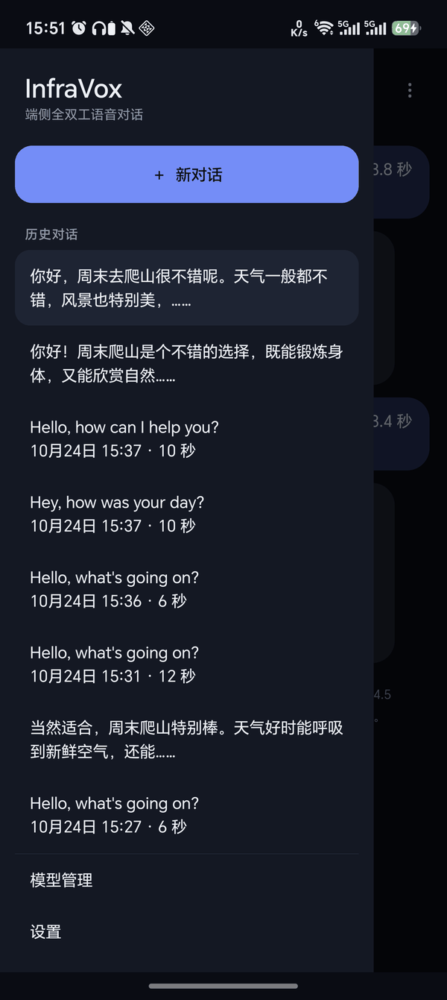

<p align="center"></p>

<h1 align="center">InfraVox</h1>

<p align="center">
  <a href="README.md">简体中文</a> · <b>English</b>
</p>

<p align="center">
  <a href="https://github.com/overmindy/InfraVox/releases/latest"></a>
  <a href="https://huggingface.co/ELAINAy/duplex-voice-models"></a>
  <a href="https://huggingface.co/openbmb/MiniCPM-o-4_5"></a>
  
  
  <a href="LICENSE"></a>
</p>

<p align="center">
  
  
  
  
</p>
<p align="center"><sub>Home · In a call (MiniCPM-o answering two questions live) · Model manager · Conversation history</sub></p>

A **full-duplex voice chat** app that runs entirely on the phone: the model listens while it speaks, you can
interrupt it at any time, and nothing goes to the network. The name is Infra (on-device runtime) + Vox (voice):
one app hosts several full-duplex speech models, all running on the Snapdragon Hexagon NPU.

**We recommend MiniCPM-o 4.5**: it talks in Chinese and English, runs faster than real time on SM8850, and keeps
answering through calls several minutes long. The app selects it by default on first launch. Moshi stays as an
experimental model; it is currently slower than real time.

- **Download the app**: [GitHub Releases](https://github.com/overmindy/InfraVox/releases/latest)
- **Model weights**: [ELAINAy/duplex-voice-models](https://huggingface.co/ELAINAy/duplex-voice-models) (downloaded inside the app; hf-mirror.com by default)

> The app UI is in Chinese for now.

## Features

- **Full-duplex calls**: microphone audio streams into the model, which speaks back while it listens and plays its reply right away; you can cut in at any time.
- **Several models**: MiniCPM-o 4.5 (Chinese / English, recommended) and Moshi (English, experimental), switched on the models page.
- **Photos**: with MiniCPM-o (the v2 bundle for SM8975) you can send a photo from the gallery or the camera before or during a call, and the model talks about it; the photo shows in the conversation.
- **Chat-style UI**: each call is split into speech-turn bubbles you can replay; conversations are stored on the device and can be exported as audio and text.
- **Model manager**: downloads from Hugging Face or a mirror with resume and per-file SHA-256 checks, and marks the variants that fit your chip.
- **Live status**: latency, per-step time, real-time factor and backlog during a call.

## Models and performance

Test device: HONOR BKQ-AN20 (Snapdragon SM8850, HTP v81), QAIRT 2.45.

| | MiniCPM-o 4.5 (recommended) | Moshi · Moshiko (experimental) |
| --- | --- | --- |
| Source | [OpenBMB](https://huggingface.co/openbmb/MiniCPM-o-4_5), the speech part on Qwen3-8B | [Kyutai](https://github.com/kyutai-labs/moshi), 7B |
| Languages | Chinese, English | English |
| Quantization | LLM LPBQ W4A16; Whisper / DiT / HiFT W8; TTS int8 on the CPU | Temporal LPBQ W4A16; DepFormer / Mimi W8 |
| Bundle size | 6.4 GB | 4.7 GB |
| Speed | 0.5–0.9 s per 1 s of speech, **faster than real time** | 100 ms per 80 ms frame on a cool phone, ~130 ms once warm (RTF 1.25–1.65), slower than real time |
| First audio | Text appears at once; speech follows about 2 s behind it | About 0.3 s |
| Quality | A 4-minute, six-question call answered in full, with 0 playback underruns | Text tokens match BF16 97.95% of the time; answers the first one or two questions, then starts circling after ~45 s and stops responding |

MiniCPM-o runs LLM decoding, Whisper and the vocoder on the NPU and the TTS on the CPU in parallel; in long calls it
drops the oldest context but keeps the system prompt, so it can keep going. Moshi runs its whole 7B backbone every
80 ms and is bound by NPU weight-read bandwidth, so latency builds up over a long call.

## Usage

1. Install the APK from Releases (Android 10+, arm64). Models are chip-specific QNN contexts; only **Snapdragon SM8850** is supported for now.
2. Open "模型管理" (Model manager) in the side drawer and download MiniCPM-o 4.5 (tagged "推荐", recommended, and already the current model on first launch). To try Moshi, download it and tap "设为当前" (Set as current).
3. Back on the home screen, tap "通话" (Call) and start talking. On the speaker, turn on echo cancellation or use headphones. You can also test with the built-in demo audio or your own WAV file.

## Repository

```sh
# Server (GPU): quantize and compile phone bundles from the official BF16 weights
bash scripts/minicpmo_build_all.sh
bash scripts/moshi_build_all.sh

# Mac: push a bundle to the connected phone, then build and install the app (development)
bash scripts/minicpmo_deploy.sh
bash scripts/moshi_deploy.sh

# Publish a model variant to Hugging Face and update the catalog
python scripts/hf_publish.py --repo ELAINAy/duplex-voice-models --variant <variant id> --bundle-dir <bundle dir>
```

| Path | Contents |
| --- | --- |
| `android/demo/` | The app (Java UI + JNI; `build.sh` produces the APK) |
| `android/minicpmo_runner.cpp`, `android/mimi_qnn_runner.cpp` | C++ runtimes for the two models; `android/qnn_runtime.h` is the shared QNN layer |
| `android/models/catalog.json` | Manifest of every model and file, bundled in the app and refreshable from the model repo |
| `scripts/minicpmo_*`, `scripts/moshi_*` | Quantization, calibration, compilation and deployment scripts |

Requirements, each graph's I/O contract, quantization details and known pitfalls are in [android/README.md](android/README.md) (Chinese).

## Acknowledgements

Built on [Qualcomm AI Hub Models](https://github.com/quic/ai-hub-models) (original README in [QAIHM_README.md](QAIHM_README.md)).
Models from [OpenBMB MiniCPM-o](https://github.com/OpenBMB/MiniCPM-o) (Apache-2.0) and [Kyutai Moshi](https://github.com/kyutai-labs/moshi) (CC-BY-4.0).
The code in this repository keeps the BSD-3-Clause license (see [LICENSE](LICENSE)); model weights follow their upstream licenses.
